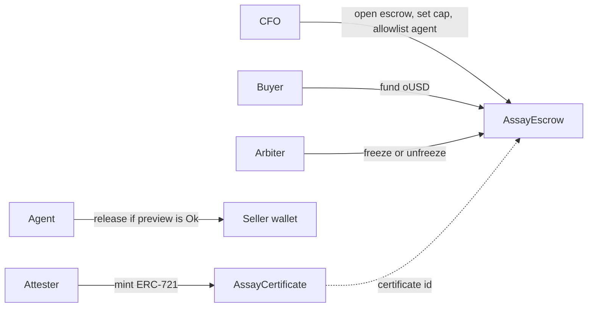

# AssayGate

Junior miners deliver concentrate under offtake contracts and then wait on provisional payment while grade and weight are argued. AssayGate tokenises each critical-minerals shipment as an ERC-721 assay certificate on Portaldot, escrows the buyer's payment in ERC-20, and lets an agent release small tranches under a cap the CFO set. A grade dispute freezes the funds.

Track: Portaldot Hacker House 2026, Ecosystem DApps. This repository is the hackathon MVP. It is not an audit and it does not custody real offtake money.

## Architecture



| Piece | Role |
| --- | --- |
| `AssayCertificate` | ERC-721. Shipment id, mine, mineral, origin, grade in basis points, dry weight in kilograms, assay URI. |
| `AssayEscrow` | Holds oUSD. Seller is the only payee. Allowlisted agents release up to the tranche cap. CFO or arbiter can freeze. |
| `MockUSD` | Demo settlement token, 6 decimals, symbol oUSD. Not tPOTv3. Gas on Portaldot is paid in tPOTv3. |
| `scripts/agent.ts` | Reads `preview`, logs the decision, and sends `release` only when the decision is `RELEASE`. |
| `scripts/demo.ts` | One-command local story: mint, fund, release, reject over cap, freeze, show the freeze revert. |
| `web/` | Desk UI on the local chain. It refuses to sign unless the chain id is 31337. |

The certificate is the attestation. The escrow does not take custody of the NFT. Repeating under-cap tranches can draw the full balance. The freeze is the stop. A cumulative agent budget is a follow-on, not this MVP.

Solidity is 0.8.24, compiled with the optimizer and `viaIR` because the certificate metadata builder is too wide for the legacy stack. Bytecode is still EVM bytecode.

## Run the demo

Requirements: Node.js 22 and npm. No Portaldot faucet, no wallet, no API key.

```bash
npm install
npm test
npm run demo
```

`npm run demo` deploys on an in-process Hardhat chain and prints the agent log. It finishes in a few seconds once dependencies are installed. Success ends with `DEMO OK`.

### Desk in the browser

Three terminals, after `npm install`:

```bash
npm run chain          # JSON-RPC at http://127.0.0.1:18545
npm run deploy:local   # writes deployments/localhost.json
npm run dev            # http://127.0.0.1:43123
```

Open [the AssayGate desk](http://127.0.0.1:43123). Click the sequence: mint, CFO opens the escrow, buyer funds 100,000 oUSD, agent releases 15,000, agent attempts 25,000, arbiter freezes. The agent log is on the page. Restart `npm run chain` and deploy again to clear the desk. State lives in the node process.

The desk signs with Hardhat's public test mnemonic. Those keys are in every Hardhat tutorial. Do not send them tPOTv3 or anything else of value.

### Agent on the local node

Fund the escrow from the desk first (steps 1–3), then:

```bash
AMOUNT=15000000000 npm run agent    # 15,000 oUSD, under the 20,000 cap, sends
AMOUNT=25000000000 npm run agent    # 25,000 oUSD, logs REJECT, does not send
```

`AMOUNT` is oUSD base units (6 decimals). `WATCH=1` polls and stops on a reject, a freeze, or `MAX_RELEASES` (default 1).

## Tests

```bash
npm test
```

The suite covers minting a certificate (grade, weight, origin), funding escrow, an allowlisted release under the cap, a release over the cap reverting, an arbiter freeze, a freeze blocking release, the allowlist rejection, and a CFO unfreeze that lets a later release succeed. The last run in this workspace is pasted in [TEST_OUTPUT.md](TEST_OUTPUT.md).

## Deploy to Portaldot testnet

Configured from the Portaldot team's V3 testnet guide (English mirror, updated 16 Oct 2026): [portaldot-v3-testnet-guide](https://github.com/ItsCogumellum/portaldot-v3-testnet-guide). Override the endpoints in `.env` if the organiser rotates them. Copy `.env.example` to `.env`.

| Item | Value |
| --- | --- |
| EVM RPC | `https://test-evm-rpc-v3.portaldot.dev` (`PORTALDOT_RPC_URL`) |
| Chain id | `420420777` (`PORTALDOT_CHAIN_ID`) |
| Substrate RPC | `wss://test-node-v3.portaldot.dev` |
| Node console | https://node-console.portaldot.dev |
| Gas token | tPOTv3, 14 decimals |
| EVM explorer | none published (leave the MetaMask explorer field empty) |

On 17 Oct 2026 a read-only `eth_chainId` against that RPC returned `0x190f1ca9`, which is 420420777. This workspace did not deploy. There is still no public faucet. The first batch of tPOTv3 goes to the native POT address submitted at hackathon registration. If that was missed, open a Discord ticket with proof of registration and the native address.

Portaldot derives a different H160 than Ethereum for the same key. Before deploying:

1. Put `DEPLOYER_PRIVATE_KEY` in `.env`. Use a fresh key. Do not use the Hardhat mnemonic.
2. In the node console, map that H160: Developer → Runtime calls → `reviveApi` → `accountId`.
3. Send tPOTv3 to the native address that comes back (it starts with `5`). The MetaMask balance of the H160 should rise.
4. Probe, then deploy:

```bash
npm run check:portaldot
npm run deploy:portaldot
```

The script prints `AssayCertificate`, `MockUSD`, `AssayEscrow`, and `deployTx`, and writes `deployments/portaldot.json`. Optional env addresses `ATTESTER_ADDRESS`, `CFO_ADDRESS`, `ARBITER_ADDRESS`, `AGENT_ADDRESS`, `BUYER_ADDRESS`, and `SELLER_ADDRESS` split the roles. When they are unset, the deployer holds them.

pallet-revive is not stock Ethereum. If the first deploy reverts, treat it as a probe: keep the local demo as the runnable proof and record the RPC error in the submission. Do not invent a contract address.

The old `feso-apps.xyz` endpoints in earlier copies of the guide were retired on 16 Oct 2026.

## DoraHacks submission checklist

- [x] Project name: AssayGate
- [x] Track: Ecosystem DApps
- [x] One sentence: AssayGate escrows critical-minerals offtake payments against an ERC-721 assay certificate and lets an agent draw tranches only under a CFO cap, with a freeze on grade dispute.
- [ ] Check-in by 24 Oct 2026, 20:00 UTC+8: progress note, repo, testnet info, initial demo
- [ ] Public GitHub URL
- [ ] Demo video, about 3 minutes, shot from [DEMO_SCRIPT.md](DEMO_SCRIPT.md)
- [ ] Pitch deck
- [ ] Thumbnail: square logo at least 512×512 and a 1200×630 banner (confirm the live form)
- [ ] Portaldot testnet contract address: **TODO** after `npm run deploy:portaldot`
- [ ] Deploy transaction hash: **TODO** after `npm run deploy:portaldot`
- [ ] AssayCertificate address: **TODO**
- [ ] MockUSD address: **TODO**

## AI disclosure

Implementation was assisted by a Cursor cloud agent. The product decisions, the offtake example, and the submission text are Shyam Desigan's to review before the BUIDL form goes in. Contracts are MIT, unaudited, and meant for a hackathon demo.

## Layout

```
contracts/          AssayCertificate, AssayEscrow, MockUSD
test/AssayGate.ts   Hardhat tests
scripts/            demo, agent, deploy, Portaldot probe
demo/shipment.json  the Kolwezi lot used by tests, demo, and desk
web/                Next.js desk
openspec/           behaviour specs for the MVP
```
